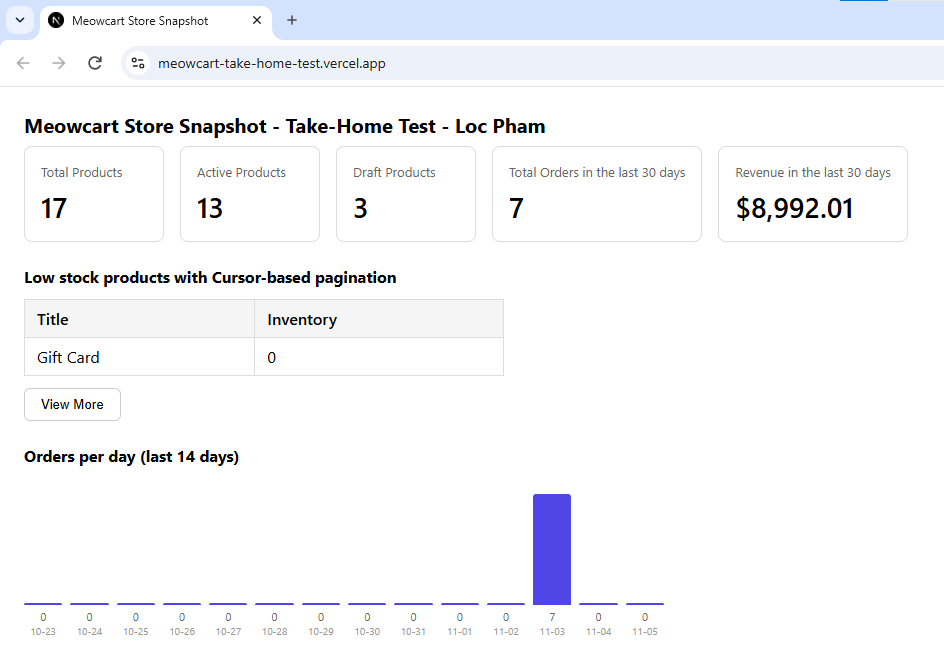
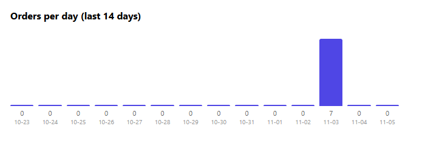

# Meowcart Store Snapshot — Take-Home Test - Loc Pham

- Demo: https://meowcart-take-home-test.vercel.app/



---

## Cài đặt và chạy project

1. Đảm bảo máy đã cài node.js version >= 20.9.0.
2. Clone repo về máy.
3. Chạy `npm install` để cài đặt dependencies.
4. Copy file `.env.example` và đổi tên thành `.env.local`.
5. Bổ sung giá trị cho các biến môi trường có trong file `.env.local`:

   ```env
   SHOPIFY_STORE_DOMAIN=meowcart-app-developer-test.myshopify.com
   SHOPIFY_ADMIN_TOKEN=<access token>
   ```

6. Chạy `npm run dev`.
7. Truy cập `http://localhost:3000` trên browser.

---

## Một số quyết định trong quá trình làm bài

### 1. Sử dụng NextJS Server để call API đến Shopify

Theo yêu cầu must-have số 3: browser không được call API trực tiếp đến Shopify.

Vì vậy, em chọn sử dụng Server Component (`src/app/page.tsx`) để lấy dữ liệu khi trang được render.

Riêng phần low-stock, khi người dùng bấm nút View More thì client sẽ gọi đến Route Handler (`src/app/api/low-stock/route.ts`) để lấy thêm dữ liệu.

Server Component và Route Handler đều là những thành phần chạy ở phía server của NextJS.

=> Access token và Shopify store domain sẽ không bị lộ ở browser

### 2. Sử dụng alias để lấy số lượng sản phẩm

Lúc đầu, em nghĩ có thể cần gọi `productsCount` nhiều lần để lấy tổng số sản phẩm, số sản phẩm active và draft.

Sau khi tìm hiểu thêm về GraphQL, em biết rằng có thể sử dụng alias để gọi nhiều lần cùng một field trong một query.

=> Em có thể lấy cả 3 kết quả trong cùng một request thay vì phải gửi 3 request.

### 3. Sử dụng chung dữ liệu orders cho nhiều phần

Shopify có `ordersCount` field để đếm số lượng đơn hàng, nhưng trong bài này em còn cần tính doanh thu và hiển thị biểu đồ số đơn theo ngày (yêu cầu 1d và yêu cầu 1 trong phần nice-to-have).

=> Em chọn cách lấy danh sách orders được tạo trong 30 ngày gần nhất và sử dụng chung dữ liệu này cho cả 3 yêu cầu trong đề bài.

Cụ thể:

- Total orders: Đếm số lượng orders lấy được.
- Total revenue: Cộng giá trị `netPaymentSet` của các orders.
- Orders chart: Nhóm các orders theo ngày để hiển thị lên biểu đồ.

### 4. Chọn netPaymentSet để tính doanh thu

Đề bài yêu cầu tính "Total revenue from orders in the last 30 days", nhưng em chưa chắc nên sử dụng field nào để kết quả phản ánh đúng doanh thu thực tế.

Sau khi tìm hiểu, em thấy có 4 field liên quan đến revenue của order như sau:

- `totalPriceSet`: Tổng giá trị của order trước khi returns. Có thể hiểu đơn giản là giá trị ban đầu của đơn hàng (một bản snapshot cho giá trị của order được capture lại khi khách mua hàng). Giá trị này bao gồm thuế và discounts, nhưng không phản ánh những khoản tiền đã refund sau đó.

- `currentTotalPriceSet`: Tổng giá trị hiện tại của order sau returns. Giá trị này cũng bao gồm thuế và discounts. Ví dụ, khi khách return một số sản phẩm trong đơn hàng thì giá trị hiện tại có thể thay đổi. Tuy nhiên, đây vẫn là giá trị của order chứ không phải số tiền thực tế mà shop đã nhận được. Vì vậy, những đơn hàng đang pending + chưa thanh toán vẫn có thể được tính ở field này.

- `totalReceivedSet`: Tổng số tiền shop đã nhận được từ khách hàng trước khi returns. Field này chưa trừ các khoản tiền refund. Shopify có một field riêng là `totalRefundedSet` để thể hiện tổng số tiền đã hoàn lại.

- `netPaymentSet`: Số tiền đã được thanh toán của order, được tính bằng tổng số tiền đã nhận trừ đi tổng số tiền đã refund.

  Công thức:

  `netPaymentSet = totalReceivedSet - totalRefundedSet`

Một vài điểm em tìm hiểu thêm trong quá trình so sánh các field:

**Returns, refunds và cancel không giống nhau.**

Em nhận thấy cần phân biệt rõ 3 trường hợp này vì chúng có thể ảnh hưởng khác nhau đến giá trị của một order.

- Return: Khách trả lại sản phẩm.
- Refund: Shop hoàn lại tiền cho khách hàng. Việc refund không nhất thiết phải đi kèm với return, ví dụ: khách hàng đã thanh toán đơn hàng nhưng lại hủy đơn trước khi giao hàng => được refund lại tiền nhưng lại không cần return (vì đơn hàng chưa được giao)
- Cancel: Đơn hàng bị hủy.

**Đối với các đơn hàng đã bị hủy:**

Em cũng tìm hiểu và thấy rằng khi lấy danh sách orders, cần kiểm tra riêng trạng thái của từng đơn hàng nếu muốn loại bỏ các đơn đã bị cancel hoặc đơn hàng test.

Shopify có một số field hỗ trợ việc này:

- `cancelledAt`: Thời điểm đơn hàng bị hủy. Nếu giá trị là `null` thì đơn hàng chưa bị hủy.
- `test`: Cho biết đây có phải là đơn hàng test hay không.

Một điểm nên lưu ý là: đơn hàng đã cancel không có nghĩa là tiền đã được refund đầy đủ.

Ví dụ, nếu một đơn hàng đã được thanh toán nhưng sau đó bị cancel mà shop chưa refund tiền thì `netPaymentSet` vẫn có thể có giá trị lớn hơn 0.

Ngược lại, nếu khách đã được refund toàn bộ số tiền đã thanh toán thì `netPaymentSet` sẽ bằng 0.

Vì vậy, nếu muốn loại bỏ đơn hàng cancel hoặc test khỏi kết quả thì cần dựa vào các field cancelledAt, test để lọc ra đơn hàng hợp lệ thay vì chỉ dựa vào `netPaymentSet`.

**Vì sao em chọn netPaymentSet?**

Sau khi so sánh, em quyết định sử dụng `netPaymentSet` vì những lý do sau:

- Em muốn tính phần tiền thực tế shop đã nhận sau khi trừ các khoản refund, thay vì chỉ lấy giá trị ban đầu của order.
- Không muốn doanh thu bị tính cao hơn thực tế khi khách hàng đã được hoàn tiền.
- Những đơn hàng chưa được thanh toán thực tế sẽ không làm tăng giá trị field này.

### 5. Low-stock có bao gồm sản phẩm không theo dõi inventory

Ở phần low-stock, em sử dụng điều kiện `inventory_total:<5` để lấy các sản phẩm có tổng inventory nhỏ hơn 5, đúng với yêu cầu của đề bài.

Một điểm em nhận thấy trong quá trình test là kết quả không chỉ bao gồm những sản phẩm đang bật tính năng theo dõi inventory (`inventoryItem.tracked = true`), mà còn có thể bao gồm cả những sản phẩm không bật tính năng này (`inventoryItem.tracked = false`).

Vì vậy, em giữ nguyên điều kiện lọc theo đề bài thay vì tự thêm điều kiện loại bỏ những sản phẩm không theo dõi inventory.

### 6. Xử lý loading và error state

Em cũng bổ sung một số trạng thái để giao diện không bị trống trong lúc chờ dữ liệu.

Cụ thể:

- Sử dụng `src/app/loading.tsx` để hiển thị loading khi trang đang được render.
- Sử dụng `src/app/error.tsx` để xử lý lỗi trong quá trình render trang.
- Đối với bảng low-stock, hiển thị "Loading..." khi đang load thêm dữ liệu.
- Nếu request thất bại, hiển thị thông báo lỗi để người dùng biết có vấn đề xảy ra.



---

## Nếu có thêm 1 giờ

Nếu có thêm thời gian, em muốn cải thiện một số phần sau:

- Xem lại điều kiện lấy orders để kết quả chính xác hơn. Ví dụ, có nên loại bỏ các đơn hàng test, đơn chưa được xử lý hoặc đơn đã bị cancel khi tính doanh thu hay không.
- Dành thêm thời gian để chỉnh sửa giao diện và sắp xếp lại một số phần code.

---

## Công cụ AI đã sử dụng

Trong quá trình làm bài, em có sử dụng Claude để hỗ trợ một số phần:

- Generate UI ban đầu cho dashboard.
- Giải thích và hỗ trợ sửa một số lỗi cú pháp khi viết câu query GraphQL.
- Giúp em tìm hiểu và so sánh ý nghĩa của các field của trong Order như `netPaymentSet`, `currentTotalPriceSet`, `totalPriceSet` và `totalReceivedSet`.

## Thời gian thực tế

- Khoảng 90 phút: Đọc tài liệu, tìm hiểu Shopify Admin GraphQL API, test query trên Postman, code và deploy project lên Vercel.
- Khoảng 60 phút: Viết README và quay video demo.
